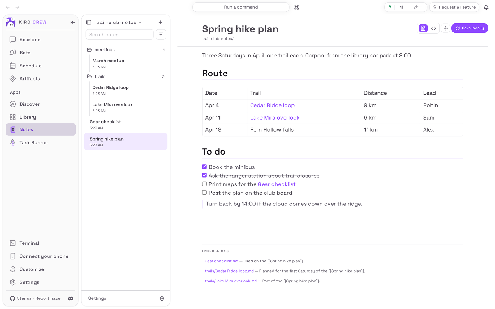
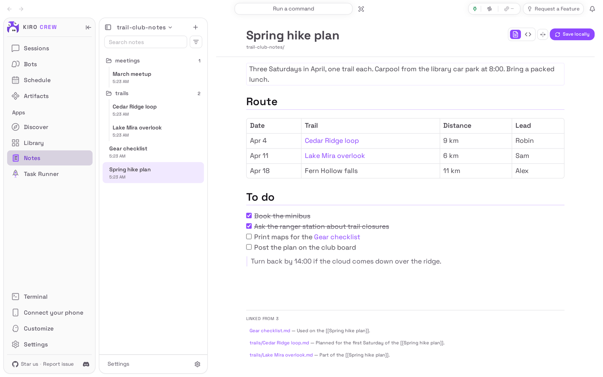
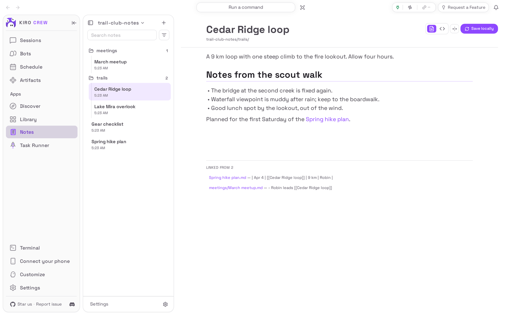
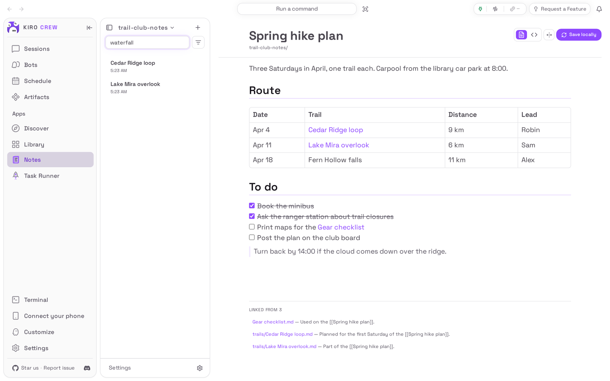

# Notes

<picture>
  <source media="(prefers-color-scheme: dark)" srcset="docs/media/hero-dark.png">
  
</picture>

**A markdown notebook in a git folder, right inside Kiro Crew.**

Notes is an app for [Kiro Crew](https://github.com/kirodotdev/KiroCrew),
the open-source personal AI agent.

## What it is

Notes adds a **Notes** page to Kiro Crew's sidebar. It keeps your notes as
plain markdown files in a git folder: one you clone from GitHub, or one you
already have on your computer, such as an Obsidian vault. You read each note
formatted, click any part of it to edit it in place, link notes with
`[[double brackets]]`, and save every change to the folder's git history with
one button.

**Get started:** open **Apps → Library**, choose **Show N disabled apps**, and
on the **Notes** tile choose **⋯ → Enable** (details in [Install](#install)).

## The problem it solves

Your notes are spread across a notes app that keeps them in its own format, a
folder of markdown files you edit in another program, and maybe a git repository
you sync by hand. Notes works on the files themselves: what you write stays
ordinary markdown in your own folder, readable by any editor, with its history
in git. It never makes a second copy of a folder you attach, and when the
version on GitHub and yours disagree it stops and tells you instead of
overwriting either.

## Top 3 use cases

### 1. Write and edit a note without leaving the page

You are planning the club's spring hikes. You open **Spring hike plan**, tick
off a task, and click the first paragraph to add a sentence. The paragraph turns
into a text box right where it was; the rest of the note stays formatted.
Press **Ctrl+Enter** (or click outside it) and it is saved to the file.



### 2. See which notes point at this one

You write `[[Cedar Ridge loop]]` in the plan and in the meeting notes. When you
open **Cedar Ridge loop**, the **Linked from** list at the bottom names every
note that links to it, with the line that does; choose one to open it.



### 3. Find a note by what is in it

You remember a waterfall but not which trail. Type **waterfall** into
**Search notes**: the panel lists every note whose title or text contains it.
Choose one to open it; clear the box to get the folders back.



## Watch it


[Watch the walkthrough as a video (MP4)](docs/media/walkthrough.mp4).

<sub>Recorded from a real Kiro Crew (the commit is in
[docs/media/media.json](docs/media/media.json)) on a throwaway home, with a
made-up hiking club notebook written through the app's own API. No AI model
appears in it. Nothing is shortened. The copy of Notes on screen is the one that
comes with Kiro Crew; this repository packages the same app.</sub>

## Install

**Today: Notes comes with Kiro Crew.** Nothing needs downloading. It starts
switched off:

1. In Kiro Crew, open **Apps → Library** in the left sidebar.
2. Choose **Show N disabled apps** (N is how many apps are switched off).
3. On the **Notes** tile, open the **⋯** menu and choose **Enable**.
4. **Notes** now appears under **Apps** in the sidebar.

**Coming soon: from the Kiro Crew App Store.** Once this app is listed there:

1. Open **Apps → Discover** in the left sidebar.
2. Search for **Notes** and choose **Install**.
3. Kiro Crew asks **Trust “Notes” to run its own code?** Notes reads and writes
   your notes folder and runs git with a small program of its own. Trusting it
   gives that program the same access Kiro Crew has (your files, your saved
   sign-ins and the internet), as the dialog says. If you are happy with that,
   choose **Trust this app**. You can take it back later in **Settings →
   Security → Third-party apps**.
4. The app installs switched off. Choose **Enable** on its page.

What you need: Kiro Crew 0.13.0 or later on a Mac, Linux or Windows computer,
with **git** installed. To clone or sync a private GitHub repository you need a
GitHub access token, or the GitHub command-line tool signed in on that computer.
A folder with no GitHub copy needs no account at all.

## First run

Open **Notes** from the sidebar. With no notebook yet it shows **Connect a
vault** (a vault is one notes folder) with two tabs:

- **Clone a repo**: paste a GitHub address into **Repository URL**, add an
  **Access token** if the repository is private, and choose **Connect vault**.
  Notes keeps its own copy of it.
- **Attach a folder**: type the path of a git folder you already have into
  **Local folder** (on a Mac, **Choose…** opens a folder picker) and choose
  **Attach folder**. Notes uses that folder in place. A folder that only lives
  on your computer works too; its changes then stay on your computer.

Tick **Sync to Kiro Crew knowledge** on either tab if you want your agents to be
able to search these notes.

## How to use it

1. **Open a note.** Choose it in the panel on the left. **Sort and view** (the
   filter icon beside the search box) switches between **Folders** and **Flat
   list** and offers six orders: by modified date, created date or file name,
   each either way.
2. **Edit it.** Click any paragraph, heading, list or table to edit that part.
   **Enter** starts a new block below, **Shift+Enter** adds a line inside this
   one, **Tab** nests a list item, **Ctrl+Enter** saves it and **Esc** throws the
   edit away. Tick a checklist box to tick it in the file. The **< >** button at
   the top shows the whole note as markdown instead.
3. **Make a note.** Choose **+** at the top of the panel for a note at the top
   level. Hover a note in the panel for **Pin**, **Duplicate**, **Rename** and
   **Delete**. A deleted note goes to a **.trash** folder inside the vault; the
   delete dialog links to it.
4. **Save to history.** Choose **Sync** at the top right: it saves your changes
   to git, takes in what changed on GitHub, and sends yours back. For a folder
   with no GitHub copy the button says **Save locally** and only saves to git.
   **⌘ S** does the same by default.
5. **Change settings.** Choose **Settings** at the bottom of the panel for your
   vaults (**Open**, **Remove**, the Knowledge switch), **GitHub access** (save or
   clear a token), and **Sync**: **Auto sync** on a timer, **Autosave to
   history**, and the shortcut.

Limits worth knowing: `[[links]]` show in colour but are not clickable in the
note itself; open the other note from the panel, or from **Linked from** on the
note being linked to. If a file changes on disk while you have it open, Notes
asks whether to **Keep my version** or **Use the version on disk** instead of
saving over it. If a sync meets a conflict, it stops, names the conflicting
notes and sends nothing.

## Settings & data

- **Where your data lives:** your notes stay in the folder you attached, or, for
  a cloned repository, under `~/.kiro/crew/workspace/md-notebook/vaults/` (or
  under `$KIROCREW_HOME` if you set it). The list of vaults, the sync settings
  and a GitHub token you saved live in
  `~/.kiro/crew/apps/md-notebook/data/state/`, a folder Kiro Crew hides from your
  agents. Which view, sort and note you had open is remembered by your browser.
- **What leaves your computer:** only what git sends to the GitHub repository a
  vault came from, when you sync or when **Auto sync** runs. A folder with no
  GitHub copy sends nothing. Turning on **Sync to Kiro Crew knowledge** indexes the
  notes into Kiro Crew's own Knowledge library on this computer.
- **Turn it off:** **Apps → Library**, open the **⋯** menu on Notes, choose
  **Disable**. Your notes, vaults and settings are kept, and **Auto sync** stops.
- **Remove it:** the same menu, **Uninstall**. **Keep app data** is ticked by
  default; untick it to delete the vault list, the settings and the saved token
  too. Your notes folders are never deleted.

## Troubleshooting / FAQ

**It says "Could not reach the Notes backend … It may still be starting."**
Notes runs a small program of its own, which takes a few seconds to start after
you enable the app or restart Kiro Crew. Wait a moment and open the page again.

**Attaching a folder says it is "Not a git repository".**
Notes attaches only a git folder. Run `git init` in it once (or use a folder you
already track with git), then attach it again.

**"Sync stopped on a merge conflict, so nothing was pushed."**
The same note changed on GitHub and here. Nothing was overwritten. Fix the
notes it names (in the **< >** view, or in your usual git tool), then choose
**Sync** again.

**"This note changed on disk since you opened it."**
Another program changed the file while you were editing. Choose **Keep my
version** to save yours over it, or **Use the version on disk** to drop your
edit.

**"The Notes backend is running older code than this page."**
Kiro Crew kept an older copy of Notes running after an update. Turn Notes off
and on again in **Apps → Library**.

**Can my agents read my notes?**
Not by default: your notes folder is yours, and the folder with the token and
vault list is hidden from them. Turn on **Sync to Kiro Crew knowledge** for a vault
and agents can search it through the Knowledge library.

## Development

Notes is a page bundle plus a small backend the Kiro Crew gateway runs. The
layout:

| Path | What it is |
|---|---|
| `app.json` | The manifest |
| `backend/` | The backend (aiohttp, run by the gateway with its own Python); `backend/_host.py` is the one place it uses Kiro Crew's own code |
| `ui/src/`, `ui/dist/index.mjs` | The page, and the committed bundle the gateway serves (no build step at install) |
| `ui/i18n/` | The page's strings in the twelve languages Kiro Crew ships |
| `tests/`, `ui/tests/` | Backend and page tests |
| `capture/` | The harness that makes the README pictures |
| `PORTING.md` | What changed from the built-in copy, and the gaps that remain |

### Install from a clone

```bash
git clone https://github.com/KiroCrewCaptain/kirocrew-app-md-notebook
kirocrew app install ./kirocrew-app-md-notebook
```

A Kiro Crew that still comes with Notes built in refuses a second app with the
same name, so this works once Notes no longer ships with it. `kirocrew app
enable md-notebook` is refused with `app_execution_denied` until the app is
trusted, and there is no command-line trust step: enable it from **Apps →
Library** instead, where **Trust this app and enable** does both.
`kirocrew app disable md-notebook` turns it off; `kirocrew app uninstall
md-notebook` keeps the data and adding `--purge-data` deletes it.

### Tests

```bash
python -m pip install -r tests/requirements.txt
python -m pytest
cd ui && npm ci && npm run typecheck && npm test && npm run build
```

`npm run build` must leave `ui/dist/` unchanged; CI checks that the committed
bundle is what the sources build.

### Re-capture the README media

The pictures and the recording come from a real, isolated Kiro Crew gateway
driven by [`capture/`](capture/README.md). After any change to what the app shows:

```bash
python capture/demo_vault.py /tmp/kc-notes-demo
python capture/capture.py --kirocrew /path/to/KiroCrew
python capture/check_readme.py
```

Then look at every image and at a few frames of the video before committing
(see [CHECKLIST.md](CHECKLIST.md)).

## License

Apache License 2.0. See [LICENSE](LICENSE) and [NOTICE](NOTICE).
